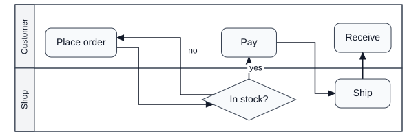
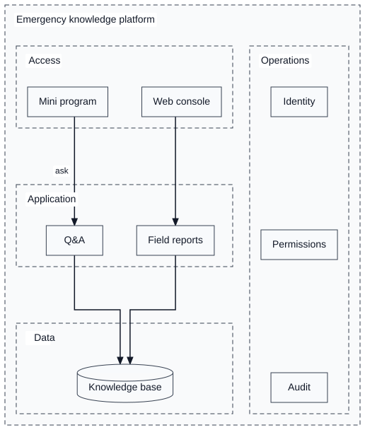
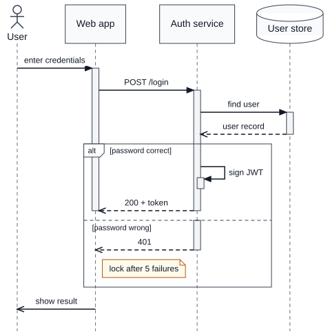
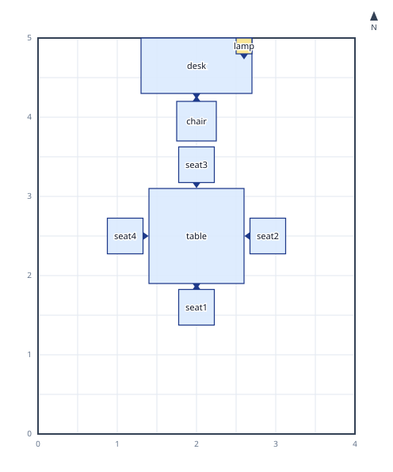
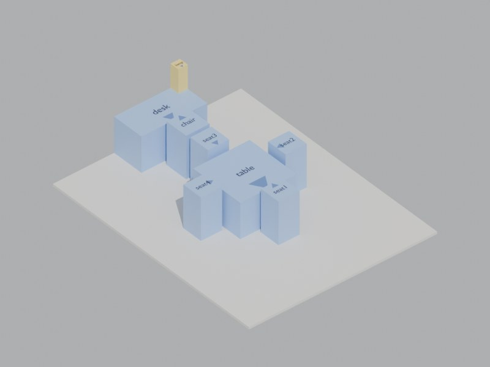
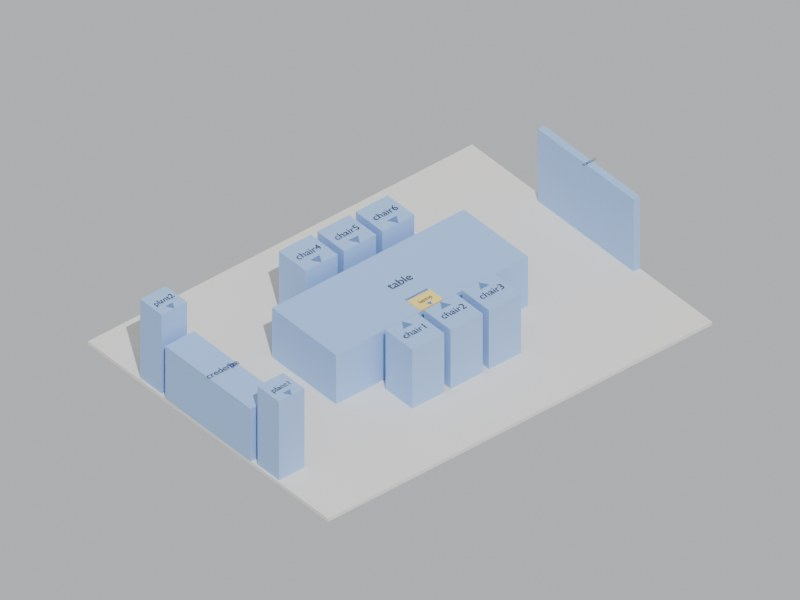
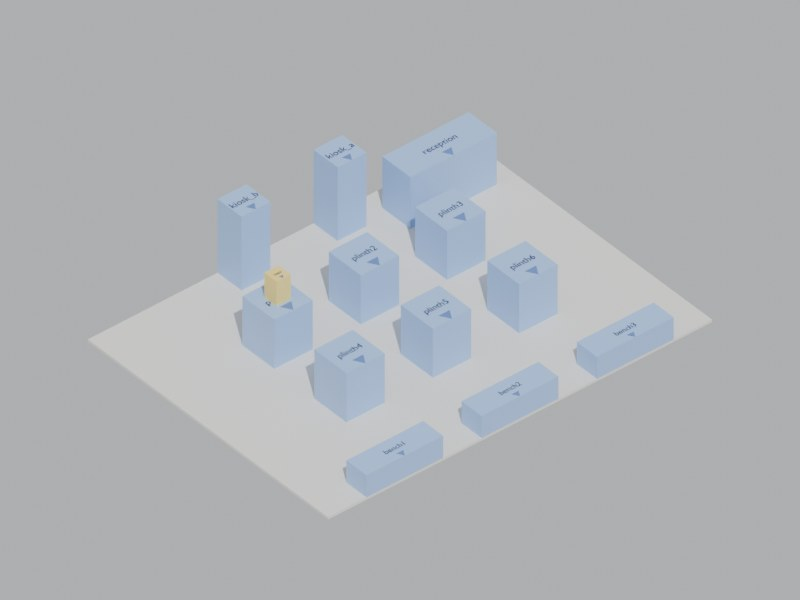

# auto-graph

[](https://www.npmjs.com/package/@crazyhappyone/auto-graph)
[](./LICENSE)
[中文文档](./README.zh-CN.md)

**Describe a diagram; get exact coordinates.** auto-graph is a deterministic geometry engine that turns diagram *intent* — a few lines of YAML — into collision-free, text-safe layouts, and exports them as SVG, editable draw.io, Excalidraw, or a plain-number geometry contract.

It is built for language models, coding agents and CI pipelines: no hand-tuned x/y, no renderer in the loop, no "look at the picture and nudge". The same input always produces the same output, byte for byte.

## At a glance

A dozen lines of content on the left; on the right, exactly what auto-graph draws from them.

<table>
<tr>
<td width="50%">

```yaml
# order.yaml
view: swimlane
title: Order fulfilment
lanes:
  customer:
    label: Customer
    steps: { order: Place order, pay: Pay, receive: Receive }
  shop:
    label: Shop
    steps: { check: In stock?, ship: Ship }
flow:
  - order -> check
  - check -> pay: yes
  - check -> order: no
  - pay -> ship -> receive
```

</td>
<td>



</td>
</tr>
</table>

## Highlights

- **Write the content, not the drawing.** Seven built-in *views* — flowchart, swimlane, layered architecture, system context, state machine, tree, sequence — take only the content of a diagram and apply that kind's conventions for you. Mistakes come back as diagnostics with the fix (`Unknown node "reveiw". Did you mean "review"?`).
- **Deterministic by construction.** Same input, same bytes. Diagrams can be snapshot-tested, diffed in review and regenerated by an agent without drift. Pass the previous result and an edit stays a small change in the picture.
- **Text-safe, CJK included.** Every label is measured before layout (Pretext, with your real fonts if you pass them), wrapped with kinsoku rules, and never overflows its shape. Mixed Chinese/Latin labels such as `订单服务（FUN-144）` break where a typesetter would break them.
- **Routes that read cleanly.** A whole-canvas layered layout with channel routing, then a tidy pass that straightens needless jogs, keeps parallel routes apart and keeps every label beside its own line. On 90 random diagrams plus the examples, runs that read as one broken line went from 138 to 1, near-parallel pairs from 88 to 2 and labels nearer another route from 74 to 8, and property tests keep it that way.
- **Real diagram semantics.** Architecture layers run through at one width with cross-cutting columns beside them; swimlane hand-offs go straight across lanes; sequence diagrams have their own solver (activation bars, fragments, notes, creation and destruction) and are valid UML by construction.
- **Editable everywhere.** SVG for documents; draw.io with native, editable shapes (sequence lifelines are real `umlLifeline` cells); Excalidraw; and a versioned JSON geometry contract that any renderer can draw with a ~100-line loop.
- **Made for agents.** Fit a diagram to A4 or a slide, get an agent report with a verdict, located issues and concrete suggestions (split this page, try the other direction), and numeric quality metrics instead of a screenshot.
- **3D scenes, too.** Describe a room in relations (`chair in-front-of desk, facing desk`, `seat around table, radius 0.9`) and get every object's position, turn and box, checked for interpenetration, floating objects and walls, as JSON or a ready-to-run Blender script.

## Quick start

```bash
npm install @crazyhappyone/auto-graph
```


Save the swimlane from [At a glance](#at-a-glance) as `order.yaml` and draw it:

```bash
npx agh --input order.yaml --output order.svg                         # SVG
npx agh --input order.yaml --format drawio --output order.drawio      # editable draw.io
npx agh --input order.yaml --page A4 --report report.json --output order.svg
```

Or from TypeScript:

```ts
import { readFileSync } from "node:fs";
import { renderDiagramDsl } from "@crazyhappyone/auto-graph";

const result = renderDiagramDsl(readFileSync("order.yaml", "utf8"), { format: "svg" });
if (result.content === undefined) throw new Error(result.diagnostics[0]?.message);
console.log(result.content); // the SVG; result.diagram holds the solved geometry
```

## Views

Name the kind of diagram with `view:` and write only its content: no shapes, containers, directions or layout settings. The view expands it into the full DSL and checks the rules of that kind. This is the easiest way for a language model to draw a correct diagram.

| View | For | Content |
| --- | --- | --- |
| `flowchart` | a process of steps and decisions | `steps`, `flow` |
| `swimlane` | a process across roles or systems | `lanes` (with their `steps`), `flow` |
| `architecture` | layered system architecture; layers run through at one width | ordered `layers` of `components` (`kind`: service, client, app, gateway, database, cache, storage, queue, user, external), `links`; optional `columns.left` / `columns.right` for cross-cutting capabilities spanning every layer, `boundary` for a frame around it all |
| `system-context` | one system, its users and neighbouring systems (C4 level 1) | `system`, `people`, `externals`, `relations` |
| `state` | states of one thing and the events between them | `states`, `transitions` (`[*]` = initial / final), `initial` |
| `tree` | org charts, breakdowns, taxonomies | `root` as a nested outline: `{ Company: [Finance, { Tech: [Web, Backend] }] }` |
| `sequence` | who calls whom, in time order (UML / SysML sequence, DoDAF OV-6c) | `participants`, `messages` (see [Sequence diagrams](#sequence-diagrams)) |

Every view reads the same way:

- Items are `id: label` or `id: { label: …, … }`. A step whose label ends in `?` is a decision; `start` / `end` (or `开始` / `结束`) are terminals.
- Relations are arrow strings: `a -> b`, chains `a -> b -> c`, fans `a, b -> c`, dashed `a -.-> b`, labels `a -> b: yes`. An end may be an id or a node's exact label.
- Mistakes come back as diagnostics pointing into your document, with the fix: an unknown or misspelled id, a decision with one branch, a step without a lane, an unreachable state, a layer no link reaches.
- `title`, `layout`, `routing` and `output` pass through (e.g. `layout: { direction: LR }`).

```bash
agh --list-views                    # the views, one line each (--json for data)
agh --view-example architecture     # a complete example document
agh --view-schema architecture      # JSON Schema of the view input (for structured output)
agh --input order.yaml --expand     # the full DSL the view produces, to hand-edit
```

Examples live in [`examples/views/`](examples/views). Register your own kind of diagram with `registerView({ id, title, summary, schema, example, expand })`: `schema` is a zod schema of the input, and `expand` returns DSL data and reports problems through its context.

### Layered architecture

Layers run through at one common width, the way an architecture diagram is drawn by hand. Capabilities that serve every layer (security, operations) go in a column beside them, spanning all of them, and `boundary` frames the whole system:

<table>
<tr>
<td width="50%">

```yaml
view: architecture
boundary: Emergency knowledge platform
layers:
  - label: Access
    components:
      mini: Mini program
      web: Web console
  - label: Application
    components:
      qa: Q&A
      report: Field reports
  - label: Data
    components:
      kb: { label: Knowledge base, kind: database }
columns:
  right:
    - label: Operations
      components:
        auth: Identity
        perm: Permissions
        audit: Audit
links:
  - mini -> qa: ask
  - web -> report
  - qa, report -> kb
```

</td>
<td>



</td>
</tr>
</table>

Underneath, this is the DSL's *group bands*: a group with `direction: vertical` stacks its members at one width, `horizontal` sets them side by side at one height, and `frame: false` makes a group a layout container that is never drawn.

### Sequence diagrams

Sequence diagrams have their own solver: participants stand side by side, each with a lifeline, and messages run top to bottom in the order written. Messages are horizontal and in order, activation bars open at a call and close when it returns, fragments nest, and lifelines are spaced just far enough apart for every label, self-call, note and fragment border between them.

<table>
<tr>
<td width="50%">

```yaml
view: sequence
title: Sign in
participants:
  user: { label: User, type: actor }
  web: Web app
  auth: Auth service
  db: { label: User store, type: database }
messages:
  - user -> web: enter credentials
  - web -> auth: POST /login
  - auth -> db: find user
  - db --> auth: user record
  - alt: password correct
    messages:
      - auth -> auth: sign JWT
      - auth --> web: 200 + token
    else:
      - guard: password wrong
        messages:
          - auth --> web: 401
          - note right of web: lock after 5 failures
  - web ->> user: show result
```

</td>
<td>



</td>
</tr>
</table>

| Write | Draws |
| --- | --- |
| `a -> b: text` | a call: solid line, filled arrowhead; activates `b` until it returns |
| `a ->> b: text` | a signal (asynchronous): open arrowhead |
| `b --> a: text` | a reply: dashed line; ends `b`'s activation |
| `a ->* b: text` | creates `b`: its head appears at this message |
| `a ->+ b`, `b -->- a` | also activate the receiver / deactivate the sender |
| `a -> a: text` | a self call: a loop on the lifeline with a short nested bar |
| `activate a`, `deactivate a`, `destroy a` | bars by hand; an X where the lifeline ends |
| `note left of a: …`, `note right of a: …`, `note over a, b: …` | notes (a note over two lifelines wraps to its full width) |
| `ref over a, b: …` | an interaction use |
| `== text ==` | a divider across the diagram |
| `alt` / `opt` / `loop` / `par` / `break` / `critical` / `neg` + `messages` | combined fragments (`else` / `and` for further operands) |

`autonumber: true` numbers the messages. With `autoActivate` (the default), a flow written as calls without replies still draws clean bars: a call's bar closes once control has returned to someone further up the call stack, and only real callbacks nest.

## 3D scenes

The same idea in three dimensions: describe a room and how things relate, and auto-graph solves where every object stands and which way it faces. It is pure math, so an agent building a 3D scene gets exact positions without guessing or looking at renders. Each result is checked for objects passing through each other, floating, or poking through a wall or the ceiling.

<table>
<tr>
<td width="50%">

```yaml
# study.yaml: relations only, no coordinates
scene: study
units: m
bounds: { width: 4, depth: 5, height: 2.8 }
minGap: 0.05
objects:
  desk:  { size: [1.4, 0.7, 0.75], front: -y }
  chair: { size: [0.5, 0.5, 0.9],  front: -y }
  lamp:  { size: [0.2, 0.2, 0.5] }
  table: { size: [1.2, 1.2, 0.75] }
  seat:  { size: [0.45, 0.45, 0.9], front: -y, count: 4 }
relations:
  - desk against wall north
  - chair in-front-of desk, facing desk, gap 0.1
  - lamp on desk, at right-back
  - table center-of room
  - seat around table, radius 0.9, evenly
  - keep clear 0.8 between desk and table
```

</td>
<td>



</td>
</tr>
</table>

| The study above in Blender | A meeting room | A showroom |
| --- | --- | --- |
|  |  |  |

The frame is x east, y north and z up, in meters, with the origin at the room's south-west floor corner. An object's `front` defaults to `-y`, and *left* and *right* are as seen by someone facing the reference's front.

| Relation | Means |
| --- | --- |
| `a in-front-of b`, `behind`, `left-of`, `right-of` (`gap`, `distance`) | beside the reference's side, centred on it |
| `a against wall north`, `a corner ne`, `a center-of room` | at a wall (back to it), in a corner, in the middle |
| `a on b, at right-back` | stands on `b` (z = its top) at a spot |
| `a facing b`, `facing east`, `rotate 30` | turns about z (to the nearest point of `b`) |
| `seat around table, radius 0.9` | evenly round a centre (polar), facing it |
| `row grid 2x3, gap 1`, `bench distribute evenly along wall south` | grids and rows |
| `a and b align x with c`, `a and b symmetric about room` | shared lines and mirror pairs |
| `keep clear 0.8 between a and b`, `minGap: 0.05` | aisles and clearances |

```bash
agh --input study.yaml --output study.scene.json      # dge-scene JSON: position, yaw, quaternion, box per object
agh --input study.yaml --format blender --output study.py   # blender -b --python study.py -- --render study.jpg
agh --input study.yaml --format svg --output study.svg       # the top view above
```

**Paths.** `person from door to desk` plans a route a person (or a declared robot) can walk, kept clear of everything by its radius. It is routed like a diagram edge and tidied by the same passes: corners move off what they turn round so people walk mid-aisle, right-angle paths are centred in their aisles, and paths meeting head-on keep right. A blocked path pushes the things at its bottleneck apart where nothing holds them (`makeWay`). A path that still cannot get through names the bottleneck and how much width is missing. Paths are timed (agents speed up, slow for corners, may set off later), agents set to walk at the same time are checked for running into each other, and the Blender script animates every agent along its path. A `frame` places the scene on the Earth: objects can be pinned by latitude and longitude or placed by distance and bearing from landmarks, and every object comes back with its latitude, longitude and height. A `terrain` grid of elevations puts the scene on uneven ground: objects stand on it or lean with the slope (`align to slope`), and limits such as `slope below 8` or `elevation above 1425` move free objects onto ground that meets them. Lines (roads, geodesic routes) take things `along` them and drone `waypoints` at a height above the ground, and `tilt` and `keep clear … between <group>` lay out solar rows and turbine fields; see the wind farm, solar and street-light examples in [`docs/scenes.md`](docs/scenes.md).


Relations that cannot all hold, and finished scenes that fail a check, come back as diagnostics naming the objects involved. The output is written anyway with `valid: false`, so the problem can be seen. Everything about scenes is in [`docs/scenes.md`](docs/scenes.md).

## How it works

auto-graph separates *prepare*, *solve* and *export*:

1. **Measure.** Every label is measured before layout through a `TextMeasurer` (Pretext by default), with CJK-aware widths and kinsoku line breaks. Shapes grow to fit their text, never the other way round.
2. **Lay out.** Diagrams with groups, swimlanes or long flows use the global layout: hierarchy-aware layering, crossing-minimising ordering that keeps every container contiguous, and a separation-constrained quadratic program (VPSC) that straightens edges and keeps containers tight. Small diagrams use a Dagre seed plus your explicit constraints.
3. **Route.** Edges follow their layer slots and turn only in the channels between layers, on tracks ordered to cross and overlap as little as possible. A tidy pass then removes needless jogs and keeps routes from reading as one line; every move is checked to add no crossing, overlap or obstacle hit.
4. **Label.** Edge labels go beside their own route, clear of nodes, other labels, group titles and lane dividers, on a white backdrop fitted to the text.
5. **Export.** Exporters draw the solved geometry as is; nothing is laid out twice.

See [`src/solver/ARCHITECTURE.md`](src/solver/ARCHITECTURE.md) for module ownership and the pipeline order.

### Global layout

`layout.mode: global` is the whole-canvas solver. Swimlane diagrams and long flows (six or more steps in a chain) use it by default; `layout.mode: dagre` opts out.

- **Layering** breaks cycles in declaration order (a "retry" edge written last is the one reversed). Swimlane hand-offs do not advance the flow, so a process that zig-zags between lanes stays compact.
- **Ordering** keeps groups and lanes contiguous with one consistent order across layers, so every container is a single rectangle.
- **Coordinates** align long edges into straight runs and size the space between layers from what must fit there: one track per bending edge, edge labels and container borders.
- **Folding** wraps a flow much longer than the page's aspect ratio into bands in reading order, like wrapped text; cuts avoid edges and never split a group.

On the benchmark set ([`test/fixtures/benchmark/elk-comparison.md`](test/fixtures/benchmark/elk-comparison.md)), DGE and ELK layered both keep every hard metric at 0 on identical input. DGE draws about half the crossings and fewer bends overall, and is faster once groups or lanes are involved.

### Incremental stability

Editing a diagram should not reshuffle it. Pass the previous result and a small edit stays a small change:

```bash
agh --input diagram.yaml --format geometry --output diagram.geometry.json   # once
# … edit diagram.yaml …
agh --input diagram.yaml --previous diagram.geometry.json --output diagram.svg
```

```ts
const first = renderDiagramDsl(source);
const next = renderDiagramDsl(edited, { previousLayout: previousLayoutOf(first.diagram!) });
```

The ordering starts from the previous order and only reorders where that removes more crossings than it disturbs (`--stability <weight>` sets the trade-off); coordinates are pulled back towards the old positions, so untouched parts stay put.

## Output

| Format | What you get |
| --- | --- |
| `svg` | A self-contained SVG (default). |
| `drawio` | draw.io XML at the solved geometry, end points pinned, crossings as per-edge jumps, native UML shapes for sequence diagrams. Opens editable in diagrams.net. |
| `excalidraw` | Excalidraw scene JSON. |
| `geometry` | The geometry contract: the solved diagram as plain numbers (below). |

Format precedence is CLI `--format`, then the document's `output.format`, then `svg`.

### Geometry contract

`--format geometry` (or `exportGeometry(diagram)`) returns the solved diagram as plain numbers, so an agent or app can draw it with any renderer instead of writing another layout routine. The format is versioned (`"format": "dge-geometry", "version": 1`) and described by a JSON Schema in [`schema/dge-geometry.v1.schema.json`](schema/dge-geometry.v1.schema.json) (also `geometryJsonSchema()`).

One coordinate system (px, origin top left, y down), every number rounded to 3 decimals, byte-stable for the same input:

- `nodes`: box, outline as a primitive (`rect` + radius, `ellipse`, `polygon`, `cylinder`) and as path commands, ports.
- `containers`: groups, swimlanes and lanes with their boxes, lane headers, parent and children.
- `edges`: end points and sides, route `points`, the stroke `path` (shortened to the arrowhead, with jumps cut in at crossings), arrowheads, label reference.
- `texts`: every label with its box, font, positioned lines and the backdrop to paint behind it.
- `zOrder` (back-to-front paint list), `metrics` and `diagnostics`.

Rendering is a loop over `zOrder`; `renderGeometrySvg(document)` is a ~100-line reference renderer that uses nothing but the document.

## For agents

**Fit a page.** `page:` in the document (or `--page`) lays the diagram out for real paper instead of an abstract canvas:

```yaml
page: A4        # A3, A5, letter, legal, slide (16:9), slide-4:3, "1200x800", "A4-landscape"
# page: { size: A4, orientation: auto, margin: 24, direction: auto }
```

The page's shape steers folding; portrait and landscape (and, with `direction: auto`, LR and TB) are tried and the layout that can be drawn largest wins. A small diagram keeps its natural size, centred. The fit reports the size labels end up at: below 8px is unreadable, below 11px small. A page that stays over capacity can be split across pages with off-page connectors (`pageSplit: auto`).

**Agent report.** `--report report.json` (or `buildAgentReport(...)`) writes what an agent needs to decide its next step, also when rendering fails:

```json
{
  "verdict": "fail",
  "summary": "Needs fixes: 200 nodes, 281 edges, 1443 crossings; 1 error(s), 0 warning(s); A4 landscape at 13% (labels 1.8px).",
  "issues": [{ "severity": "error", "code": "page.unreadable", "where": "page", "message": "…", "fix": "…" }],
  "page": { "size": "A4", "orientation": "landscape", "scale": 0.129, "fontPx": 1.8, "readable": false },
  "suggestions": ["Split into about 38 page(s), e.g. one per group (g0_0, g0_1, …), each with the edges it needs.", "…"]
}
```

**Measure, don't look.** `--metrics metrics.json` writes whole-canvas quality metrics (overlaps, label overflow, crossings, bends, shared endpoints, whitespace, lane fill, …), and `measureRouteReadability(diagram)` counts the readability defects the tidy pass clears: runs that read as one line, near-parallel runs, labels nearer another route, labels against group titles and ends off their node's outline.

## TypeScript API

```ts
import {
  exportDrawio,
  exportGeometry,
  exportSvg,
  measureLayoutQuality,
  renderDiagramDsl,
} from "@crazyhappyone/auto-graph";

const { diagram, diagnostics } = renderDiagramDsl(source); // views or full DSL, YAML or JSON
if (diagram === undefined) throw new Error(diagnostics.map((d) => d.message).join("\n"));

const svg = exportSvg(diagram);
const drawio = exportDrawio(diagram);
const geometry = exportGeometry(diagram);
const metrics = measureLayoutQuality(diagram);
```

The lower-level pipeline is public too: `parseDiagramDsl` → `normalizeDiagramDsl` → `solveDiagram(normalized.diagram, options)` → any exporter, with options for route kind, label placement, constraints, fonts (`registerFonts`) and a custom `TextMeasurer`.

### The full DSL

Views expand into a general DSL of nodes, edges, groups, swimlanes and constraints, which you can write directly when you need exact control:

```yaml
title: Architecture
layout: { direction: LR }
nodes:
  web: { label: Web App, shape: rounded-rectangle }
  api: { label: API, shape: hexagon }
  db: { label: Database, shape: cylinder }
edges:
  - web -> api: calls
  - api -> db: reads
groups:
  backend: { label: Backend, nodes: [api, db] }
constraints:
  - { kind: relative-position, source: api, reference: web, relation: right-of, offset: { x: 160, y: 0 } }
```

Shapes: rectangle, rounded-rectangle, ellipse, diamond, parallelogram, hexagon, cylinder. Constraints: exact, relative, align, distribute, containment. More in [`examples/`](examples).

Dense, position-preserving pages (MBSE / DoDAF style) have a further set of routing controls — obstacle-avoiding and short-orthogonal routing, named ports, dependency rails, external label callouts, strict deliverability and automatic remediation. They are documented in [`docs/advanced-routing.md`](docs/advanced-routing.md).

## CLI reference

```bash
agh --input diagram.yaml --output diagram.svg                    # SVG unless --format / output.format say otherwise
agh --input diagram.yaml --format drawio --output diagram.drawio
agh --input diagram.yaml --format excalidraw --output diagram.excalidraw.json
agh --input diagram.yaml --format geometry --output diagram.geometry.json
cat diagram.yaml | agh --json > diagram.svg                      # stdin in, stdout out, diagnostics as JSON
agh --input diagram.yaml --page A4 --report report.json --metrics metrics.json --output diagram.svg
agh --input diagram.yaml --font ./NotoSansSC-Regular.otf --output diagram.svg   # measure with real fonts
agh --input diagram.yaml --previous diagram.geometry.json --output diagram.svg  # incremental
agh --input diagram.yaml --padding 16 --output diagram.svg       # margin around the drawing
agh --list-views | --view-example <view> | --view-schema <view> | --input view.yaml --expand
agh --input room.yaml --format scene-json|blender|svg    # scene documents (a top-level `scene` key)
```

`--json` writes diagnostics to stderr as JSON; `--verbose` also prints informational ones.

## Development

```bash
npm ci
npm run verify      # typecheck, build, tests, lint (what CI runs)
```

The test suite includes golden and determinism tests, property tests over random diagrams (hard metrics stay at 0, readability stays within budget), a scale benchmark up to 1000 nodes, and the ELK comparison (`DGE_ELK=1 npx vitest run test/benchmark/elk-comparison.test.ts`). See [`CHANGELOG.md`](CHANGELOG.md) for what changed in each release.

## Credits

auto-graph uses [`@chenglou/pretext`](https://github.com/chenglou/pretext) for renderer-free text measurement and [`@dagrejs/dagre`](https://github.com/dagrejs/dagre) as the seed layout for small diagrams. MIT licensed.
