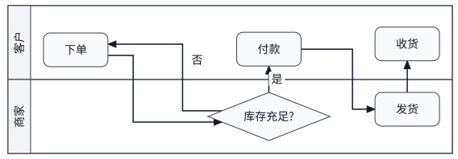
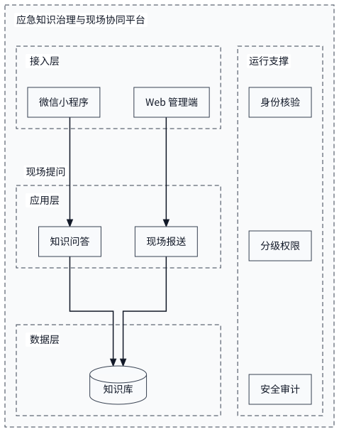
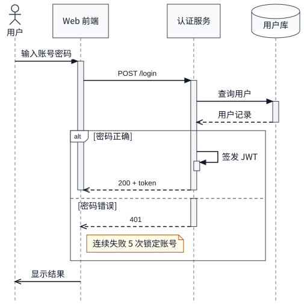

# auto-graph

[](https://www.npmjs.com/package/@crazyhappyone/auto-graph)
[](./LICENSE)
[English](./README.md)

**写下图要表达什么，拿到精确的坐标。** auto-graph 是一个确定性的图表几何引擎：把几行 YAML 描述的图表意图，解算成不重叠、文字不溢出的版式，并导出为 SVG、可编辑的 draw.io、Excalidraw，或纯数字的几何契约。

它为大模型、编码 Agent 和 CI 流水线而设计：不用手调 x/y，不依赖渲染器反馈，也不需要“看图再挪一挪”。同样的输入，永远得到逐字节相同的输出。

## 一眼看懂

左边是十几行内容描述，右边就是 auto-graph 根据它画出的图，未经任何手工调整。

<table>
<tr>
<td width="50%">

```yaml
# order.yaml
view: swimlane
title: 订单履约
lanes:
  customer:
    label: 客户
    steps: { order: 下单, pay: 付款, receive: 收货 }
  shop:
    label: 商家
    steps: { check: 库存充足?, ship: 发货 }
flow:
  - order -> check
  - check -> pay: 是
  - check -> order: 否
  - pay -> ship -> receive
```

</td>
<td>



</td>
</tr>
</table>

## 核心特点

- **只写内容，不画图。** 内置七种视图：流程图、泳道图、分层架构图、系统上下文图、状态机、树形图、时序图。你只需写图的内容，这类图的画法规范由视图负责。写错了会得到带修改建议的诊断，例如 `Unknown node "reveiw". Did you mean "review"?`。
- **确定性输出。** 同样的输入，逐字节相同的输出。图可以做快照测试、在代码评审里比对差异，Agent 反复生成也不会漂移。把上一版结果传回去，一处小修改在图上也只是一处小变化。
- **文字安全，中文友好。** 所有标签都在布局前测量：默认用 Pretext，传入实际字体时按真实字体精确测量。折行遵守避头尾规则，文字绝不溢出图形。像 `订单服务（FUN-144）` 这样中英混排的标签，断行位置和排版软件一致。
- **线路清爽易读。** 全局分层布局配合通道走线，再经过一轮整理：去掉多余的拐弯，让并行的线保持间距，让每个标签贴着自己的线。在 90 张随机图加全部示例上，“读起来像一条断线”的情况从 138 处降到 1 处，近距离并行从 88 处降到 2 处，标签离别的线更近从 74 处降到 8 处，并由属性测试持续守住。
- **懂图表的语义。** 架构图的各层横向拉通到同一宽度，横切能力以竖列贯穿各层；泳道之间的交接直接横穿泳道；时序图有专门的求解器（激活条、组合片段、备注、创建与销毁），画出来天然就是合法的 UML。
- **处处可编辑。** SVG 用于文档；draw.io 输出原生可编辑的图形，时序图的生命线就是真正的 `umlLifeline`；还有 Excalidraw，以及带版本号的 JSON 几何契约，任何渲染器用约 100 行循环就能画出来。
- **为 Agent 而生。** 可以把图适配到 A4 或幻灯片，得到一份 Agent 报告：结论、定位到原文的问题和具体建议（比如“拆成几页”“换个方向试试”），以及一组质量指标，用数字代替截图。
- **也能解 3D 场景。** 用关系描述房间（`chair in-front-of desk, facing desk`、`seat around table, radius 0.9`），拿到每个物体的位置、朝向和包围盒，并已检查穿插、悬空和穿墙；可输出 JSON，或一个直接可运行的 Blender 脚本。

## 快速上手

```bash
npm install @crazyhappyone/auto-graph
```


把[一眼看懂](#一眼看懂)里的泳道图保存为 `order.yaml`，然后画出来：

```bash
npx agh --input order.yaml --output order.svg                         # SVG
npx agh --input order.yaml --format drawio --output order.drawio      # 可编辑的 draw.io
npx agh --input order.yaml --page A4 --report report.json --output order.svg
```

或者在 TypeScript 中调用：

```ts
import { readFileSync } from "node:fs";
import { renderDiagramDsl } from "@crazyhappyone/auto-graph";

const result = renderDiagramDsl(readFileSync("order.yaml", "utf8"), { format: "svg" });
if (result.content === undefined) throw new Error(result.diagnostics[0]?.message);
console.log(result.content); // SVG 文本；result.diagram 是解算后的几何
```

## 视图

用 `view:` 指明图的种类，然后只写内容：不用写形状、容器、方向和布局参数。视图会把内容展开成完整的 DSL，并检查这类图的规则。这是让大模型画出正确图表最简单的方式。

| 视图 | 适用于 | 内容 |
| --- | --- | --- |
| `flowchart` | 由步骤和判断组成的流程 | `steps`、`flow` |
| `swimlane` | 跨角色或跨系统的流程 | `lanes`（及各自的 `steps`）、`flow` |
| `architecture` | 分层系统架构，各层拉通到同一宽度 | 有序的 `layers` 及其 `components`（`kind`：service、client、app、gateway、database、cache、storage、queue、user、external），`links`；可选 `columns.left` / `columns.right` 放贯穿各层的横切能力，`boundary` 给整体加外框 |
| `system-context` | 一个系统及其用户和周边系统（C4 第一层） | `system`、`people`、`externals`、`relations` |
| `state` | 一个对象的状态及其间的事件 | `states`、`transitions`（`[*]` 表示初始 / 终止）、`initial` |
| `tree` | 组织架构、分解结构、分类体系 | `root`，写成嵌套大纲：`{ 公司: [财务, { 技术: [前端, 后端] }] }` |
| `sequence` | 谁按什么顺序调用谁（UML / SysML 时序图，DoDAF OV-6c） | `participants`、`messages`（见[时序图](#时序图)） |

所有视图的写法一致：

- 条目写成 `id: 标签` 或 `id: { label: …, … }`。标签以 `?` 结尾的步骤是判断；`开始` / `结束`（或 `start` / `end`）是起止节点。
- 关系用箭头字符串表示：`a -> b`，链式 `a -> b -> c`，扇入 `a, b -> c`，虚线 `a -.-> b`，带标签 `a -> b: 是`。两端可以写 id，也可以写节点的完整标签。
- 写错时，诊断会指向原文中的位置并给出修改建议：未知或拼错的 id、只有一个分支的判断、不属于任何泳道的步骤、无法到达的状态、没有任何连线的层。
- `title`、`layout`、`routing`、`output` 原样透传（例如 `layout: { direction: LR }` 可改变默认方向）。

```bash
agh --list-views                    # 列出所有视图（加 --json 输出数据）
agh --view-example architecture     # 一份完整的示例文档
agh --view-schema architecture      # 视图输入的 JSON Schema（用于结构化输出）
agh --input order.yaml --expand     # 查看视图展开后的完整 DSL，便于手工调整
```

示例见 [`examples/views/`](examples/views)。也可以用 `registerView({ id, title, summary, schema, example, expand })` 注册自己的图表类型：`schema` 是输入的 zod 模式，`expand` 返回 DSL 数据，并通过上下文报告问题。

### 分层架构

各层横向拉通到同一宽度，和手工画架构图的习惯一致。服务于所有层的能力（安全、运维）放在侧边的竖列里，贯穿全部各层；`boundary` 给整个系统加上外框：

<table>
<tr>
<td width="50%">

```yaml
view: architecture
boundary: 应急知识治理与现场协同平台
layers:
  - label: 接入层
    components:
      mini: 微信小程序
      web: Web 管理端
  - label: 应用层
    components:
      qa: 知识问答
      report: 现场报送
  - label: 数据层
    components:
      kb: { label: 知识库, kind: database }
columns:
  right:
    - label: 运行支撑
      components:
        auth: 身份核验
        perm: 分级权限
        audit: 安全审计
links:
  - mini -> qa: 现场提问
  - web -> report
  - qa, report -> kb
```

</td>
<td>



</td>
</tr>
</table>

底层对应 DSL 的“分组条带”：`direction: vertical` 的分组把成员按同一宽度纵向堆叠，`horizontal` 则按同一高度横向并排；`frame: false` 让分组只作布局容器，不会被画出来。

### 时序图

时序图有专门的求解器：参与者横向排开，每人一条生命线，消息按书写顺序自上而下排列。消息水平且有序，激活条从调用开始、在返回时结束，组合片段正确嵌套，生命线之间的间距刚好容得下其间的标签、自调用、备注和片段边框。

<table>
<tr>
<td width="50%">

```yaml
view: sequence
title: 用户登录
participants:
  user: { label: 用户, type: actor }
  web: Web 前端
  auth: 认证服务
  db: { label: 用户库, type: database }
messages:
  - user -> web: 输入账号密码
  - web -> auth: POST /login
  - auth -> db: 查询用户
  - db --> auth: 用户记录
  - alt: 密码正确
    messages:
      - auth -> auth: 签发 JWT
      - auth --> web: 200 + token
    else:
      - guard: 密码错误
        messages:
          - auth --> web: 401
          - note right of web: 连续失败 5 次锁定账号
  - web ->> user: 显示结果
```

</td>
<td>



</td>
</tr>
</table>

| 写法 | 画出 |
| --- | --- |
| `a -> b: 文字` | 同步调用：实线、实心箭头；`b` 激活到调用返回为止 |
| `a ->> b: 文字` | 异步消息：开口箭头 |
| `b --> a: 文字` | 返回：虚线；结束 `b` 的激活 |
| `a ->* b: 文字` | 创建 `b`：它的头部出现在这条消息处 |
| `a ->+ b`、`b -->- a` | 额外激活接收方 / 结束发送方的激活 |
| `a -> a: 文字` | 自调用：生命线上的回环，带一段嵌套激活条 |
| `activate a`、`deactivate a`、`destroy a` | 手动控制激活条；生命线在 X 处结束 |
| `note left of a: …`、`note right of a: …`、`note over a, b: …` | 备注（跨两条生命线的备注按整个宽度折行） |
| `ref over a, b: …` | 交互引用 |
| `== 文字 ==` | 横贯全图的分隔线 |
| `alt` / `opt` / `loop` / `par` / `break` / `critical` / `neg` + `messages` | 组合片段（其余分支写在 `else` / `and` 下） |

`autonumber: true` 给消息编号。默认开启 `autoActivate`，即使流程只写调用、不写返回，激活条也是干净的：控制权回到调用栈上层后，被调用方的激活条随即结束，只有真正的回调才会嵌套。

## 3D 场景

同样的思路用到三维：描述房间里有什么、它们之间是什么关系，auto-graph 解算出每个物体放在哪里、朝向哪边。全程是纯数学计算，agent 搭建 3D 场景时直接拿到精确坐标，不用猜，也不用看渲染图再调整。每个结果都会检查有没有物体互相穿插、悬空，或穿出墙壁和天花板。

<table>
<tr>
<td width="50%">

```yaml
# study.yaml: relations only, no coordinates
scene: study
units: m
bounds: { width: 4, depth: 5, height: 2.8 }
minGap: 0.05
objects:
  desk:  { size: [1.4, 0.7, 0.75], front: -y }
  chair: { size: [0.5, 0.5, 0.9],  front: -y }
  lamp:  { size: [0.2, 0.2, 0.5] }
  table: { size: [1.2, 1.2, 0.75] }
  seat:  { size: [0.45, 0.45, 0.9], front: -y, count: 4 }
relations:
  - desk against wall north
  - chair in-front-of desk, facing desk, gap 0.1
  - lamp on desk, at right-back
  - table center-of room
  - seat around table, radius 0.9, evenly
  - keep clear 0.8 between desk and table
```

</td>
<td>


</td>
</tr>
</table>

| 上面的书房在 Blender 中 | 会议室 | 展厅 |
| --- | --- | --- |
|  |  |  |

坐标系：x 朝东、y 朝北、z 朝上，单位是米，原点在房间西南角的地面。物体的正面 `front` 默认朝 `-y`；“左”“右”按站在参照物正面、看着它时的左右来算。

| 关系 | 含义 |
| --- | --- |
| `a in-front-of b`、`behind`、`left-of`、`right-of`（`gap`、`distance`） | 在参照物某一侧，并与它对齐 |
| `a against wall north`、`a corner ne`、`a center-of room` | 背靠某面墙、放在墙角、放在房间中央 |
| `a on b, at right-back` | 放在 `b` 上（z 为其顶面）的某个位置 |
| `a facing b`、`facing east`、`rotate 30` | 绕竖直轴转向（朝向 `b` 离自己最近的点） |
| `seat around table, radius 0.9` | 绕中心均匀排一圈（极坐标），并朝向中心 |
| `row grid 2x3, gap 1`、`bench distribute evenly along wall south` | 网格与成排 |
| `a and b align x with c`、`a and b symmetric about room` | 对齐与镜像对称 |
| `keep clear 0.8 between a and b`、`minGap: 0.05` | 通道与最小间距 |

```bash
agh --input study.yaml --output study.scene.json      # dge-scene JSON：每个物体的位置、朝向、四元数、包围盒
agh --input study.yaml --format blender --output study.py   # blender -b --python study.py -- --render study.jpg
agh --input study.yaml --format svg --output study.svg       # 上面的俯视图
```

关系之间互相矛盾，或者解出的场景没通过检查时，会返回诊断信息并指出涉及哪些物体；结果照样输出，标为 `valid: false`，方便直接看到问题在哪。场景的完整说明见 [`docs/scenes.zh-CN.md`](docs/scenes.zh-CN.md)。

## 工作原理

auto-graph 把**准备**、**解算**、**导出**三步分开：

1. **测量。** 布局前先通过 `TextMeasurer`（默认 Pretext）测量所有标签，按中文宽度计算，并按避头尾规则折行。图形随文字长大，而不是把文字塞进图形。
2. **布局。** 带分组、泳道或长流程的图使用全局布局：层级感知的分层；尽量减少交叉、且保证每个容器连续不断的排序；再用带间距约束的二次规划（VPSC）把连线拉直、把容器收紧。小图则用 Dagre 生成初始布局，再叠加你写的约束。
3. **走线。** 连线沿各层的位置直行，只在层间通道里转弯，轨道顺序以交叉和重叠最少为目标。随后的整理步骤去掉多余的拐弯，避免两条线读成一条；每一步移动都会检查，确保不新增交叉、重叠或穿越障碍。
4. **标注。** 连线标签放在自己那条线旁边，避开节点、其他标签、分组标题和泳道分隔线，并垫一块贴合文字的白底。
5. **导出。** 导出器直接绘制解算好的几何，不会重新排版。

模块职责与管线顺序见 [`src/solver/ARCHITECTURE.md`](src/solver/ARCHITECTURE.md)。

### 全局布局

`layout.mode: global` 是整张画布的求解器。泳道图和长流程（连续 6 步以上）默认使用它；设置 `layout.mode: dagre` 可以关闭。

- **分层**：按声明顺序打破环路，写在最后的“重试”连线会被反向。泳道之间的交接不推进流程，来回穿梭于泳道之间的流程依然紧凑。
- **排序**：分组和泳道保持连续，并在各层之间顺序一致，每个容器都是一个完整的矩形。
- **坐标**：长连线对齐成直线，层间距离按需要容纳的内容计算：每条转弯的线一条轨道，加上连线标签和容器边框。
- **折行**：比页面比例长得多的流程，会像文字换行一样按阅读顺序折成多段；折行处尽量不切断连线，也绝不拆开分组。

在基准测试集上（[`test/fixtures/benchmark/elk-comparison.md`](test/fixtures/benchmark/elk-comparison.md)），输入完全相同时，DGE 和 ELK layered 的硬性指标都保持为 0。DGE 的交叉总数约为 ELK 的一半，折点更少；涉及分组或泳道时也更快。

### 增量稳定

改一处，图不应该整体重排。把上一版结果传回去，小修改在图上也只是小变化：

```bash
agh --input diagram.yaml --format geometry --output diagram.geometry.json   # 第一次
# … 修改 diagram.yaml …
agh --input diagram.yaml --previous diagram.geometry.json --output diagram.svg
```

```ts
const first = renderDiagramDsl(source);
const next = renderDiagramDsl(edited, { previousLayout: previousLayoutOf(first.diagram!) });
```

排序从上一版的顺序出发，只有能减少的交叉多于打乱的顺序时才会调整（用 `--stability <权重>` 调节取舍）；坐标会被拉回原来的位置，没有改动的部分保持不动。

## 输出

| 格式 | 得到 |
| --- | --- |
| `svg` | 自包含的 SVG（默认）。 |
| `drawio` | draw.io XML，保持解算后的几何，端点固定，交叉处为逐线跳线，时序图使用原生 UML 图形。在 diagrams.net 中打开即可编辑。 |
| `excalidraw` | Excalidraw 场景 JSON。 |
| `geometry` | 几何契约：纯数字形式的解算结果（见下）。 |

格式优先级依次为 CLI `--format`、文档中的 `output.format`，最后默认 `svg`。

### 几何契约

`--format geometry`（TypeScript 中为 `exportGeometry(diagram)`）把解算结果输出为纯数字。Agent 或应用可以直接用任意渲染器绘制，不必再各自写一套布局。格式带版本号（`"format": "dge-geometry", "version": 1`），JSON Schema 见 [`schema/dge-geometry.v1.schema.json`](schema/dge-geometry.v1.schema.json)（也可调用 `geometryJsonSchema()`）。

统一坐标系（px，原点在左上角，y 向下），所有数值保留 3 位小数，同一输入逐字节稳定：

- `nodes`：外框，外形的图元表示（`rect` + 圆角、`ellipse`、`polygon`、`cylinder`）及路径命令，端口。
- `containers`：分组、泳道与泳道行，含外框、表头和父子关系。
- `edges`：起止点及所在边、路由点 `points`、描边路径 `path`（截到箭头处，交叉处切入跳线）、箭头、标签引用。
- `texts`：每个标签的框、字体、逐行位置，以及需要垫在下面的白底。
- `zOrder`（从后到前的绘制顺序）、`metrics` 与 `diagnostics`。

渲染就是遍历 `zOrder`；`renderGeometrySvg(document)` 是只依赖这份文档、约 100 行的参考渲染器。

## 面向 Agent

**适配页面。** 在文档中写 `page:`（或使用 `--page`），图会按真实纸张排版，而不是一块抽象画布：

```yaml
page: A4        # A3、A5、letter、legal、slide（16:9）、slide-4:3、"1200x800"、"A4-landscape"
# page: { size: A4, orientation: auto, margin: 24, direction: auto }
```

页面的形状会引导折行；横竖版（以及 `direction: auto` 时的 LR / TB 两个方向）都会尝试，取能画得最大的方案。小图保持原始尺寸并居中。适配结果会报告标签在纸上的实际字号：小于 8px 视为不可读，小于 11px 视为偏小。仍然放不下的页面可以拆成多页，并用跨页连接符标注（`pageSplit: auto`）。

**Agent 报告。** `--report report.json`（或 `buildAgentReport(...)`）输出 Agent 决定下一步所需的信息，渲染失败时也会输出：

```json
{
  "verdict": "fail",
  "summary": "Needs fixes: 200 nodes, 281 edges, 1443 crossings; 1 error(s), 0 warning(s); A4 landscape at 13% (labels 1.8px).",
  "issues": [{ "severity": "error", "code": "page.unreadable", "where": "page", "message": "…", "fix": "…" }],
  "page": { "size": "A4", "orientation": "landscape", "scale": 0.129, "fontPx": 1.8, "readable": false },
  "suggestions": ["Split into about 38 page(s), e.g. one per group (g0_0, g0_1, …), each with the edges it needs.", "…"]
}
```

**用数字检查，不用看图。** `--metrics metrics.json` 输出整张画布的质量指标（重叠、文字溢出、交叉、折点、共享端点、空白率、泳道填充率等）；`measureRouteReadability(diagram)` 统计线路可读性缺陷：读成一条线的走线、近距离并行、离别的线更近的标签、贴着分组标题的标签，以及不在节点轮廓上的端点。

## TypeScript API

```ts
import {
  exportDrawio,
  exportGeometry,
  exportSvg,
  measureLayoutQuality,
  renderDiagramDsl,
} from "@crazyhappyone/auto-graph";

const { diagram, diagnostics } = renderDiagramDsl(source); // 视图或完整 DSL，YAML 或 JSON 均可
if (diagram === undefined) throw new Error(diagnostics.map((d) => d.message).join("\n"));

const svg = exportSvg(diagram);
const drawio = exportDrawio(diagram);
const geometry = exportGeometry(diagram);
const metrics = measureLayoutQuality(diagram);
```

底层管线同样公开：`parseDiagramDsl` → `normalizeDiagramDsl` → `solveDiagram(normalized.diagram, options)` → 任意导出器，可以配置走线方式、标签位置、约束、字体（`registerFonts`）以及自定义 `TextMeasurer`。

### 完整 DSL

视图会展开成一套通用的 DSL：节点、连线、分组、泳道和约束。需要精确控制时可以直接编写：

```yaml
title: 系统架构
layout: { direction: LR }
nodes:
  web: { label: Web 应用, shape: rounded-rectangle }
  api: { label: API, shape: hexagon }
  db: { label: 数据库, shape: cylinder }
edges:
  - web -> api: 调用
  - api -> db: 读取
groups:
  backend: { label: 后端, nodes: [api, db] }
constraints:
  - { kind: relative-position, source: api, reference: web, relation: right-of, offset: { x: 160, y: 0 } }
```

形状：rectangle、rounded-rectangle、ellipse、diamond、parallelogram、hexagon、cylinder。约束：exact、relative、align、distribute、containment。更多见 [`examples/`](examples)。

对于需要保留坐标的密集页面（MBSE / DoDAF 风格），还有一组走线控制：避障走线与短正交走线、命名端口、依赖轨道、外置标签、严格交付模式和自动补救。详见 [`docs/advanced-routing.zh-CN.md`](docs/advanced-routing.zh-CN.md)。

## CLI 速查

```bash
agh --input diagram.yaml --output diagram.svg                    # 默认 SVG，除非 --format / output.format 另有指定
agh --input diagram.yaml --format drawio --output diagram.drawio
agh --input diagram.yaml --format excalidraw --output diagram.excalidraw.json
agh --input diagram.yaml --format geometry --output diagram.geometry.json
cat diagram.yaml | agh --json > diagram.svg                      # 从标准输入读、写到标准输出，诊断以 JSON 输出
agh --input diagram.yaml --page A4 --report report.json --metrics metrics.json --output diagram.svg
agh --input diagram.yaml --font ./NotoSansSC-Regular.otf --output diagram.svg   # 用真实字体测量
agh --input diagram.yaml --previous diagram.geometry.json --output diagram.svg  # 增量稳定
agh --input diagram.yaml --padding 16 --output diagram.svg       # 图外留白
agh --list-views | --view-example <视图> | --view-schema <视图> | --input view.yaml --expand
agh --input room.yaml --format scene-json|blender|svg    # 场景文档（顶层有 `scene` 键）
```

`--json` 把诊断以 JSON 写到标准错误；`--verbose` 额外输出提示级诊断。

## 开发

```bash
npm ci
npm run verify      # 类型检查、构建、测试、代码检查（与 CI 一致）
```

测试包括：golden 与确定性测试；随机图上的属性测试（硬性指标保持为 0，可读性不超出预算）；最多 1000 个节点的规模基准；以及与 ELK 的对比测试（`DGE_ELK=1 npx vitest run test/benchmark/elk-comparison.test.ts`）。每个版本的变化见 [`CHANGELOG.md`](CHANGELOG.md)。

## 致谢

auto-graph 使用 [`@chenglou/pretext`](https://github.com/chenglou/pretext) 做无需渲染器的文本测量，使用 [`@dagrejs/dagre`](https://github.com/dagrejs/dagre) 作为小图的初始布局。采用 MIT 许可证。
