# 3D 场景

[English](./scenes.md)

场景文档描述一个房间、里面的物体，以及物体之间的关系。auto-graph 解算出每个物体放在哪里、朝向哪边，并检查结果。全程是纯数学计算，不依赖任何 3D 软件，agent 拿到的是精确数值，可以直接交给 Blender、游戏引擎或机器人规划器。

目前覆盖：平面布局加上下叠放（2.5D），物体绕竖直轴转动；人和机器人的路径；用经纬度把场景放到地球上（局部坐标系，大场地用地图投影）；以及起伏的地面（地形）：物体贴地站立、随坡倾斜，并满足坡度和高程限制；以及线（道路、测地线航线），可沿线布置物体、在线上排布无人机航点。glTF、USD、Cesium 导出和 MCP 工具在 #122 中完成。

## 坐标系

- x 朝东、y 朝北、z 朝上，单位是米。
- 原点在房间西南角的地面，地面范围从 `[0, 0]` 到 `[width, depth]`。
- 东南西北只是房间方向的名字：`north` 就是 +y，不代表地理上的北。
- 角度用度，从上往下看逆时针为正，0 度指向东。
- 物体的 `size` 是转动前的 `[宽, 深, 高]`：宽沿物体自身的 x 轴，深沿自身的 y 轴。
- `front` 是转动前正面的朝向，默认 `-y`，即朝南，对着站在房间南侧、面朝北看的人。
- “左”“右”按站在参照物正面、看着它时的左右来算。默认朝向下，左是西（-x），右是东（+x）。

## 文档结构

```yaml
scene: study                 # 名称
units: m                     # m（默认）、cm 或 mm；下面所有长度都用这个单位
bounds: { width: 4, depth: 5, height: 2.8 }   # height 可省略（省略则不检查天花板）
minGap: 0.05                 # 同一平面上物体之间的最小间距（默认 0）
makeWay: true                # 路径被挡时把物体挪开（默认 true）
objects:
  desk:  { size: [1.4, 0.7, 0.75] }
  chair: { size: [0.5, 0.5, 0.9], front: -y, label: Chair, asset: office_chair }
  seat:  { size: [0.45, 0.45, 0.9], count: 4 }     # 展开为 seat1 … seat4，也可以整组写作 "seat"
  plant: { size: [0.4, 0.4, 1.1], position: [0.35, 0.35], yaw: 30 }   # 手动钉住
relations:
  - desk against wall north
  - chair in-front-of desk, facing desk, gap 0.1
```

物体字段：

| 字段 | 说明 |
| --- | --- |
| `size` | `[宽, 深, 高]`，必须为正数 |
| `front` | `-y`（默认）、`+y`、`-x`、`+x` |
| `count` | 展开为 `id1 … idN`；id 以数字结尾时展开为 `id-1 …` |
| `position` | 钉住底面中心 `[x, y]`（不能与 `count` 同用） |
| `yaw` | 钉住转角（度） |
| `label` | 俯视图和 Blender 里显示的名字 |
| `asset` | 用 Blender 中的同名集合代替方块 |

关系里的长度默认使用文档的单位，也可以带后缀：`gap 10cm`、`radius 0.9m`。

## 关系

每条关系占一行：主语、动词，后面用逗号接修饰子句。主语可以是一个物体、一个 `count` 组，或用 `and` 连接的多个物体。只接受单个主语的关系写成一个组时，会对组里每个成员分别生效。

| 关系 | 含义 | 修饰 |
| --- | --- | --- |
| `a in-front-of b` / `behind` / `left-of` / `right-of` | `a` 放在 `b` 的那一侧（就近对齐到世界坐标轴），在垂直方向上与 `b` 居中对齐 | `gap`（两侧之间的距离，默认 `minGap`）或 `distance`（中心距） |
| `a against wall north`（也可写 `against north wall`，或 `n`/`s`/`e`/`w`） | `a` 的一侧贴墙；没有其他指定时背对这面墙 | `gap` |
| `a corner ne`（`nw`、`se`、`sw`） | 放在墙角，同时贴着两面墙 | `gap` |
| `a center-of room` / `a center-of b` | 放在房间中央，或 `b` 的底面中心 | |
| `a on b` | 放在 `b` 上（z 为 `b` 的顶面），并随 `b` 一起转动 | `at center`、`front`、`back`、`left`、`right`、`front-left` …（`right-back` 这种写法也可以） |
| `a facing b` / `facing north` | 转向 `b` 离自己最近的点，或某个方向 | |
| `a rotate 30` | 转一个角度（也可写 `30deg`） | |
| `a and b align x with c` | 中心 x 与 `c` 相同（`y` 同理） | |
| `g distribute evenly along x` / `along wall south` | 成排等距排列；沿墙时同时贴墙 | `gap`（固定间距，整排居中） |
| `g grid 2x3` | 行 × 列，北边为第一行，从西到东 | `gap` |
| `g around c, radius 0.9` | 绕 `c` 均匀排成一圈（极坐标），各自朝向 `c` | `start`（起始角度，默认 270，即南）；写 `facing` / `rotate` 时不再自动朝向 `c` |
| `a and b symmetric about room` / `about c` | 关于房间或 `c` 的中线镜像对称 | `axis x` / `axis y`（默认取两者分开的那个轴） |
| `keep clear 0.8 between a and b` | 两者至少相距这么远（通道） | |
| `keep clear 350 between g` | 组 `g` 中每两个物体至少相距这么远 | |
| `a tilt 25` | 向正面倾斜这么多度，最低一角落在地面上（也可作修饰：`a facing south, tilt 25`） | |
| `a on terrain` / `a align to slope` | 站在地面上（有地形的场景里，地面上的物体都是如此）/ 贴合坡面倾斜 | `align to slope`（跟在 `on terrain` 后） |
| `a slope below 8` | 脚下地面的坡度不超过该值（度，也可写 `<`、`<=`） | |
| `a elevation between 100 and 300` / `above 100` / `below 300` | 脚下地面的高程在这个范围内 | |

`facing` 和 `rotate` 也可以跟在其他动词后面，例如 `chair in-front-of desk, facing desk`。

## 求解过程

1. **叠放**：`on` 关系构成一片森林。被支撑的物体放在支撑物顶面，按 `at` 在支撑物自身坐标系里取落点；其余物体放在地面上。
2. **朝向**：按以下优先级决定：
   - 钉住的 `yaw`、`rotate` 或 `facing`（给出的角度互相冲突时报错）；
   - 否则 `around` 朝向圆心；
   - 否则靠墙的物体背对墙；
   - 否则被支撑的物体随支撑物转动，两者正面一致。
3. **平面布局**：x、y 两个轴各解一个带分离约束的二次规划，用的是 auto-graph 的 VPSC 求解器，四面墙也作为变量参与。
   - 大部分关系转成某个轴上的等式。
   - "在某物旁边"类关系额外把两者中心轻轻拉齐。
   - 所有物体都约束在房间内。
   - 重叠（间距小于 `minGap` 或 `keep clear` 的距离）按 VPSC 去除节点重叠的方式处理：分离约束加在重叠较小的那个轴上，但不会加在两者相对位置已被锁死的轴上；加完仍然重叠的，换到另一个轴再试一次。
   - 没有任何约束的物体，初始时按网格铺在房间里。
4. **多轮迭代**：朝向某物体需要知道双方的位置，支撑面上的落点又取决于朝向，所以平面布局和叠放分多轮求解，直到朝向不再变化。
5. **检查**：
   - 穿插：对转动后的底面轮廓和高度区间做分离轴检测；
   - 是否越过墙壁或天花板；
   - 被支撑物体的中心是否落在支撑面外；
   - 关系是否成立；
   - `keep clear` 距离；
   - 是否出现非有限数值。

   伸出边缘和小于 `minGap` 只给警告。

同样的输入，逐字节相同的输出。

## 路径

路径是智能体必须能走通的路线，例如人从门口走到书桌、扫地机器人回到充电座。它在场景里对应图表中的连线，用的也是同一套路由方法（#128）。

```yaml
openings:
  door: { wall: south, at: 0.6, width: 0.9 }   # 门中心距墙的西端（或南端）0.6 m
agents:
  robot: { radius: 0.18, height: 0.1, speed: 0.5, accel: 0.5 }   # 内置 person（半径 0.25，高 1.8，1.2 m/s，1 m/s²）；自定义 person 时未写的速度沿用内置值
paths:
  - person from door to desk
  - person from door to shelf, clearance 0.05
  - robot from door to shelf, orthogonal
  - person from chair to door, via lamp and table
  - person from desk to door, comfort 0.3
  - robot from shelf to door, start 4          # 第 4 秒出发（单位：秒）
```

- **构型空间**：把智能体缩成一个点，挡路的物体都按“智能体半径 + `clearance`”外扩，墙也同样往里收。物体底部低于智能体高度才算挡路，所以矮机器人能从架在立柱上的桌面下方钻过去。
- **起点和终点**：走到物体时，站在它正面；正面被占了，就改去左侧、右侧或背面。某一侧中间离墙太近时，站位会沿着这一侧滑动；每个空着的站位都会依次尝试。放在其他物体上的东西（桌上的台灯）从它所在支撑物的四周去够。走到门洞时，站在门内侧；门洞宽度至少要等于智能体宽度加两侧的 `clearance`。路径去往不在布局里的物体时会报告（`scene.path.unplaced`）。
- **路由**：
  - 默认求任意角度的最短路：在外扩后的轮廓角点上建可见图，用 A* 搜索。
  - 写了 `orthogonal` 时，改用 auto-graph 给图表连线布线的稀疏网格路由器，只走直角。
- **优化**：最短路会贴着每个拐过的角走。和图表连线布线之后一样，每条路径再经过 auto-graph 自己的几道整理：
  - **走在过道中间**：任意角度路径的拐点从所绕的物体旁移开，在过道允许时多留出至多 `comfort`（默认 0.15 m，`clearance` 之外），再重新拉紧。直角路径使用图表连线的通道居中：两次转弯之间的每一段移到所在过道的中线，同一过道里的多段均匀分开；连着端点的段保持在端点所在的线上。路径长度最多比最短路长 15%；`comfort 0` 保留最短路。
  - **分道**：两条路径在同一段上迎面相遇时靠右走：一条向自己行进方向的右侧让开，直到两条色带刚好相接（让不开就换另一条，或者各让一半）。端点不动，在端点之后才让开。同向的路径共用一条道（一前一后走）。让道不会让路径超出 15% 的长度上限；`comfort 0` 的路径保持最短路。最后仍迎面共用的路段都会报告位置和原因：窄到无法错身（`scene.path.single-file`），或者超出长度上限、有一条是 `comfort 0`、在轮数上限内没排开（`scene.path.head-on`）。
  - **绕路**：路径长度超过各途经点之间直线距离的两倍（且多出 1 m 以上）时给出提示，说明有东西挡在直路上。
- **时间**：智能体从静止出发、最后停稳，以 `accel`（默认 1 m/s²）加速和减速，速度不超过 `speed`（默认 1 m/s，人是 1.2 m/s）。在拐角处减速到 `speed · (1 + cos θ) / 2`，θ 是转过的角度：直行不减速，直角拐弯减到一半，掉头要先停下。每条路径都给出到达每个折点的时刻和全程耗时，出发时刻是 `start`（默认 0，最大 1,000,000 s）。
- **相遇**：写了 `start` 的路径共用一个时钟。两个智能体在路上会碰到时给出警告（`scene.path.meet`；检查是精确的，不是采样：两人都处在加速、匀速或减速的每一段里，距离是时间的多项式），包括时间、地点，以及后一个推迟多久出发就能错开。没写 `start` 的路径只是路线，不是时间表，不参与比较。
- **检查**：每条路径都单独对照物体真实的旋转轮廓和墙壁检查一遍。输出里的 `clearance` 是智能体边缘到最近物体的距离。
- **让路**：路径会反过来影响布局。某条路径走不通时，把它最窄处的两样东西（两个物体，或一个物体和一面墙）在平面布局里隔开，再重新求解。间距是路径宽度，放得下时两侧再各加 `comfort`（另加 2 cm）。最窄处是放在支撑物上的东西时，挪动它的支撑物。最多重复四次，所以一条有多处窄口的路径可以逐个打通。只有原来能走通的路径没被挡住、有进展（被挡的路径变少、缺的宽度变少，或者过了一处窄口到下一处），并且其他检查都没有变差时才采用新布局：不出现原来没有的问题，警告不升级为错误，量值不变大（越墙多远、穿插多深、悬出多少、间距差多少）。消掉一个问题不能抵偿另一个新问题。关系和固定位置照样成立，只挪动没被约束住的物体。最后保留尝试过的最好布局，一样好时保留原布局。其中确实保持住、并让路径走通的过道才会报告（`scene.path.made-way`）。`makeWay: false` 保留仅由关系得到的布局。
- **走不通时**：逐步缩小智能体，直到能走通为止。能通过的最宽智能体有多宽，路上最窄的地方就有多宽，于是报出这个瓶颈，例如：`"person" cannot get from "door" to "desk": the way between "cabinet" and the west wall is 0.4 m wide; it needs 0.5 m (0.1 m short).`。门洞比智能体窄时，单独报告。

规划好的路径会出现在 `dge-scene` JSON、俯视图和 Blender 脚本里：
- JSON 的 `paths` 给出折点、长度、宽度、净空、出发时刻、各点时刻和全程耗时；`agents` 给出每个智能体的尺寸、速度和加速度。`clearance` 是全程（含端点）的最小距离：智能体会一直走到目标跟前。
- 俯视图把路径画成和智能体一样宽的色带，每走一秒标一个点。
- 门洞在三处都会出现。

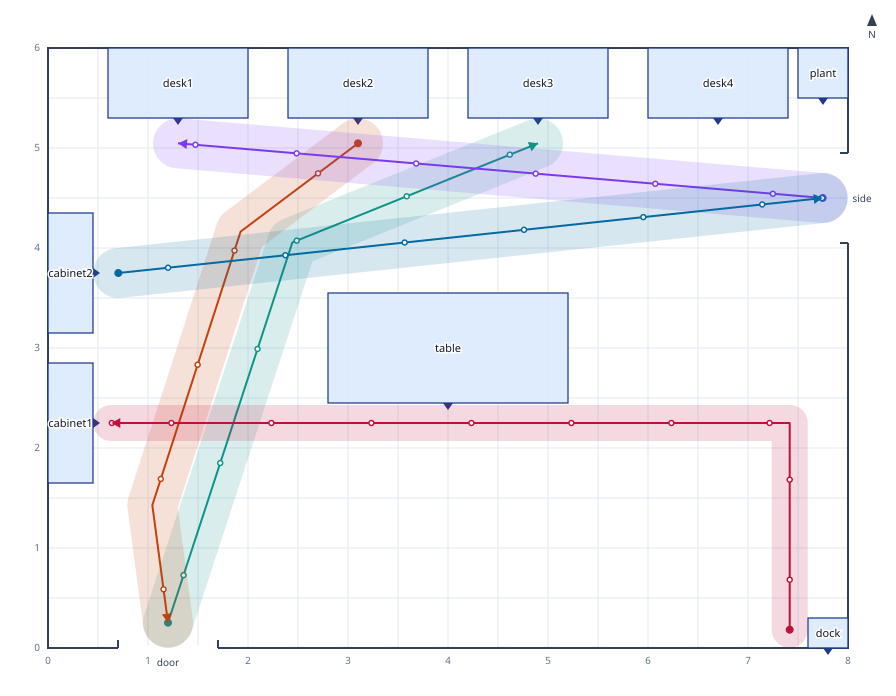

`examples/scene/storeroom.yaml` 里货架没有任何约束。只按关系摆放时两个货架相距 0.7 m，0.7 m 宽的推车留不出余量；求解器把它们挪到相距 1.02 m（0.7 m，两侧各加 0.15 m 的 comfort，再加 2 cm）：

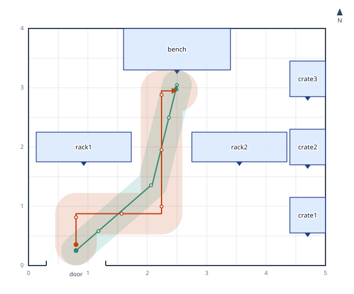

## 放到地球上

场景可以放到地球上。求解器仍在场景自己的坐标系里以米为单位计算；经纬度通过 `frame` 和 `landmarks` 输入，并随每个物体一起输出。

```yaml
frame:
  origin: { lat: 39.99, lon: 116.39, alt: 45 }   # WGS84 经纬度（度），高度（米）
  datum: WGS84          # 或 GCJ02 / BD09：文档里所有经纬度都按它读取
  anchor: [0, 0]        # 位于原点的场景点（默认西南角）
  heading: 0            # 场景 +y 轴的真方位角，顺时针度数（默认 0）
  projection: auto      # enu | utm | web-mercator（默认 auto：10 km 内用 enu，超出用 UTM）
  zone: 50              # 可选：指定 UTM 带号，代替原点所在的带
landmarks:
  gate:     { lat: 39.99009, lon: 116.39035 }      # 供关系引用的固定点
  fountain: { lat: 39.99045, lon: 116.39070 }
objects:
  pavilion: { size: [12, 10, 6], geo: { lat: 39.99070, lon: 116.39110 } }   # 用经纬度固定位置
relations:
  - kiosk 25m bearing 60 from gate        # 真方位角，从正北顺时针
  - lamp 8m north-of pavilion             # 也可以是 north-east-of、ne-of、south-of……
  - info at gate, facing fountain
  - bench around fountain, radius 12
```

- **坐标系**：场景的米制坐标挂在 `origin` 处的局部东北天坐标系上：场景点 `anchor` 位于原点，场景 +y 轴指向真方位角 `heading`。场景地面是原点高度处的水平面，所以经纬度可以精确往返，物体高度等于原点高度加 z。`heading: 0` 时场景的“北”（方位词、`against wall north`）就是真北；否则这些词仍指场景自己的方向，俯视图里的箭头指向真北。
- **地标**是固定点。`at`、距离加方位、`around` 和 `facing` 都可以用地标代替物体。没写高度的地标在地面上（原点高度）。
- **距离**：相对地标时，`<长度> bearing <度> from` 和 `<长度> north-of` 严格沿 WGS84 测地线计算。相对物体时在场地平面上计算，平面的北是原点处的真北；离原点东西方向每 100 m 子午线收敛约 0.001°，那里的方位与真北可能差这么多。长度也可以用 `km`。没有 frame 时，方位以场景的北为准。
- **坐标偏移**：GCJ-02 和 BD-09（国内地图服务的坐标）用公开的转换公式换算，这是官方转换的近似，误差在几米以内；反算相对这些公式的误差远小于 1 毫米。内部存储和输出一律用 WGS84。
- **适用范围与投影**：局部东北天坐标系（`projection: enu`）适用于原点 10 km 以内的场地。保持默认的 `auto` 时，场地超出这个范围（边界离锚点、任一经纬度点、或从地标出发的距离超过 10 km），就改用原点所在的 UTM 投影带，并给出 `scene.geo.projection`（提示），写明带号和 EPSG 代码。UTM 场地伸进相邻的带时，仍统一用本带投影，并给出 `scene.geo.zone-crossing`（警告，附最远处的格网比例）。用投影时，场景米就是格网上离原点的米数，并旋转到让 +y 指向原点处的真方位角 `heading`（格网北与真北在原点处相差子午线收敛角）。UTM 在中央子午线上的比例是 0.9996，离中央子午线 3° 处约为 1.001。`web-mercator`（EPSG:3857，用于和地图瓦片对齐）在原点处东西、南北分别缩放成真实米数，经度按原点为中心展开，所以横跨 180° 经线的场地不会被拆开。坐标系放不下的点会报错（`validate.scene.geo-extent`）；所选投影放不下坐标原点本身时同样报错（指向 `frame.origin`），并且在构造坐标系之前就检查。距离在投影前按地球上的位置量取：离局部坐标系原点超过 10 km（地球另一面的点不会被折回原点附近）、离 UTM 中央子午线超过 15° 或在 80°S–84°N 之外（不支持极地 UPS），或超出 Web Mercator 的 ±85.05°。显式写 `enu` 的场景超过 10 km 时给出 `scene.geo.extent`。
- **输出**：每个物体给出 `geo`（其 `position` 的纬度、经度、高度），文档给出 `geo`（坐标系）和 `landmarks`。Blender 脚本把它们记为自定义属性（物体上的 `dge_geo`，集合上的 `dge_geo_origin`）。

测地线和坐标系数学（`src/scene/geo`）与 GeographicLib 对照（10 km 内距离、方位误差 < 1e-6 米/度），GCJ-02/BD-09 公式与 coordtransform 包对照，UTM（Krüger 六阶级数，带内精度达纳米级）和 Web Mercator 与 proj4 对照（误差 < 1e-6 m）；坐标往返误差：局部坐标系 10 km 内、投影坐标系 100 km 内均 < 1 mm。

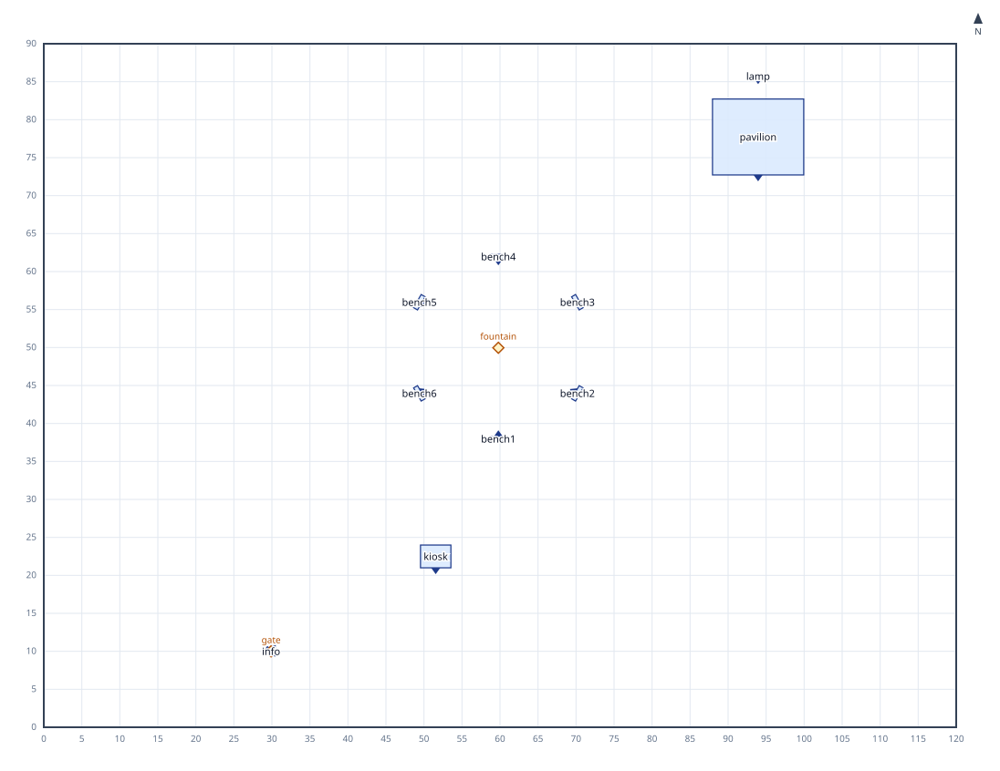

## 地形

场景可以放在起伏的地面上，地面用一张高程网格给出。

```yaml
terrain:
  grid:
    origin: [0, 0]      # 西南角采样点的场景 x、y（默认 [0, 0]）
    spacing: 10         # 采样间距（米），也可以写 [x, y]
    heights:            # 高程，行从南到北，每行从西到东
      - [1400.1, 1400.3, 1400.9]
      - [1400.6, 1401.2, 1402.0]
  base: 1400            # 场景 z = 0 处的高程（默认 0；有 frame 的场景取坐标原点的高度）
relations:
  - panel on terrain, align to slope      # 随坡面倾斜
  - turbine slope below 8                 # 坡度上限（度，相对水平），底面下处处适用
  - turbine elevation above 1425          # 也可以写 below <b>、between <a> and <b>
```

- **地面**：采样点之间是每个网格单元四个角点的双线性曲面，连续，对平面精确。场景 z 等于高程减去 `base`。有 `frame` 的场景里 `base` 就是坐标原点的高度，所以物体 `geo` 里的高度就是它脚下地面的高程。
- **贴地**：地面上的每个物体都以底面中心站在地面上（`on terrain` 是显式写法）。直立物体保持直立；脚下地面起伏超过 10 cm 时给出 `scene.terrain.uneven`（提示），说明最低边悬空多少、最高边埋入多少。`align to slope` 让物体贴合坡面：它的上方向是脚下地面拟合平面的法线，旋转是先绕 z 转，再做这次倾斜（输出 `quaternion`，并给出 `up`）。放在支撑物上的物体照旧站在支撑面上；支撑物本身倾斜时会报错。
- **限制条件**：`slope below` 和 `elevation above / below / between` 对整个底面成立，并且精确计算：底面按它跨过的每个网格单元裁剪，最陡坡度出现在裁剪片的角点（双线性单元的梯度平方是凸函数），极端高程出现在裁剪片的边上。物体脚下的地面不满足条件时，会被移到最近的满足条件的位置：在场地范围内、与地面上其他物体保持 `minGap` 和 `keep clear` 的距离，并且只移动没有被约束住的物体；被钉住或被关系固定的物体不动，由 `scene.terrain.slope` / `scene.terrain.elevation`（错误）说明问题。每次移动都会报告（`scene.terrain.moved`）。搜索是贪心的，逐个物体、就近优先；合适的地面很少时可能放不下所有物体，此时错误会保留。
- **路径**沿地面走：折点和智能体都在地面高度。智能体能否从物体下方通过，取物体底面与其下方最高地面之间的净空来判断（底面范围再向外扩出智能体半径和净空距离），所以中间离地很高、但上坡一端很低的横梁会挡住去路；天花板（`bounds.height`）也从每个物体脚下的地面量起。
- **数据**：`terrain.parseAsciiGrid(text)`（从包里导入）读取 ESRI ASCII 栅格（`.asc`，GIS 软件从 DEM 导出的格式），得到可直接用于 `terrain.grid` 的 `{ origin, spacing, heights }`，坐标是文件自己的（用 `origin` 放到场景里）。`terrain.sampleTerrain(fn, …)` 按函数生成网格（测试用的合成地形）。
- **输出**：文档给出 `terrain`（origin、spacing、base 和 heights）。俯视图画等高线（每第五条加深并标出高程）。Blender 脚本在双线性曲面上生成地面网格（每个单元最多切成 4 × 4 个四边形），让贴坡物体倾斜，路径和智能体贴着地面，地标用标杆标出。

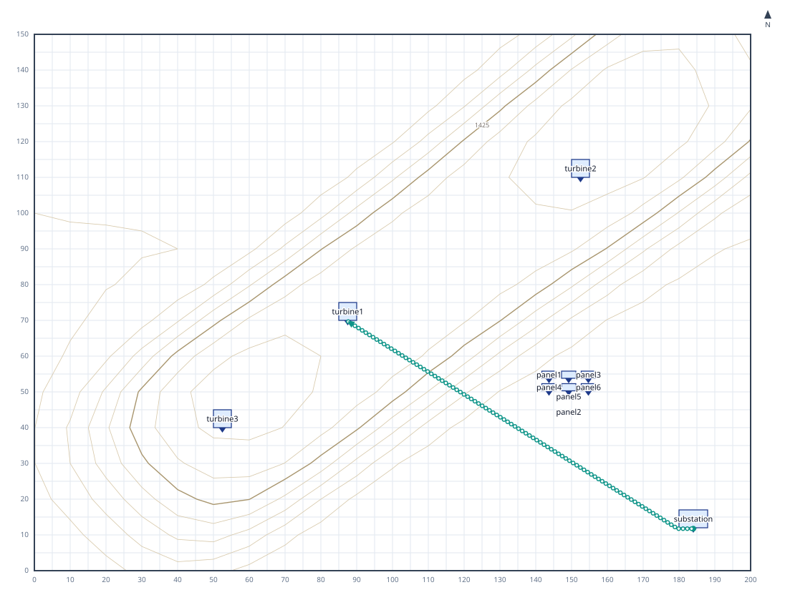

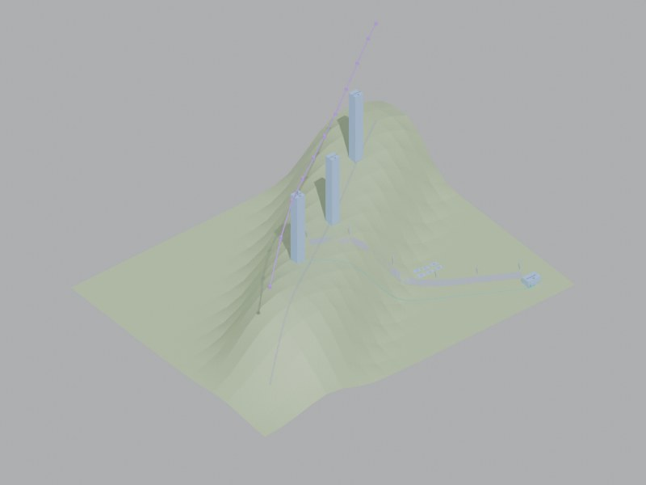

## 线与航点

线是折线（道路、围栏、航线），可以沿线布置物体，也可以在线上排布无人机航点。

```yaml
lines:
  road:   { points: [[184, 22], [150, 40], [120, 62], [92, 76]], width: 5 }   # 场景 x, y；5 m 宽的道路
  route:  { geo: [{ lat: 39.9, lon: 116.4 }, { lat: 31.2, lon: 121.5 }] }   # 沿测地线（大圆）
waypoints:
  scan: { line: survey, spacing: 20, height: 60, min: 30 }   # 或 count: 8；默认每个折点一个
relations:
  - lamp along road, offset 4                 # 从头到尾均匀分布
  - lamp along road, spacing 25, from 5, offset -3, rotate 0
```

- **线**用场景坐标（`points`）或经纬度（`geo`，需要 `frame`）给出。经纬度线在各点之间沿 WGS84 测地线（球面上即大圆）走：每段都会加密（最长一段的 1%，最多 100 m 一个点），投影后仍保持弧形。输出中每条线都贴在地面上（地面的 z，或 0），并给出长度。
- **道路**：带 `width` 的线是地面上的一条带子，地面上的物体要避开。压到上面的物体会报错（`scene.line.overlap`），并给出压入的深度。没有被其他东西固定的物体会被挪到最近的、不压路的位置（`scene.line.moved`）；按坡度或海拔条件挪动的物体同样避开道路。沿道路布置（`along`）的物体，`offset` 至少要等于路宽的一半加上物体自身进深的一半。输出给出路宽；俯视图画出路面，Blender 脚本、glTF 和 USD 把路面铺在地面上。
- **`along`** 把一组物体（或用 `and` 连起来的物体）按弧长沿线排开：从 `from`（默认 0）起每隔 `spacing` 米一个；不写 spacing 时从 `from` 到终点均匀分布。`offset` 把物体放到行进方向右侧（负数为左侧）。每个物体默认转向面对这条线（在线上时则顺着线），除非关系里写了 `facing` 或 `rotate`。间距超出线长会报错（`validate.scene.along-overflow`）。这些位置是平面上的固定点，与之矛盾的关系或钉住位置会报冲突；在地形上物体贴地站立。
- **航点**位于线上、离地 `height` 高：沿线每隔 `spacing` 米一个（终点也有一个）、按 `count` 均匀分布，或每个折点一个。输出给出它们的 [x, y, z]（有 frame 时还有经纬度和高度），以及 `lowest`：航点之间直线航段上任意一处离地的最低高度（有地形时每八分之一个网格单元量一次）。航段低于 `min` 时给出 `scene.waypoint.low`；航段穿过物体包围盒时给出 `scene.waypoint.collision`（都是警告）。
- 俯视图里线画成虚线，航点画成航段上的小圈并标出高度；Blender 脚本把线画在地面上，航点画成小标记并用航线相连。

## 户外示例

三个示例把地形、限制条件、线和阵列组合在一起：

- **[`windfarm.yaml`](../examples/scene/windfarm.yaml)**：3 km × 2 km 的高原，100 m 网格。八台风机只给了限制条件（`slope below 5`、`elevation above 1450`、`keep clear 350 between turbine`），求解器把它们逐台放到山顶上。已经站在合格地面上的风机原地不动，其余的被移走。检修道路旁立着路标。
- **[`solar.yaml`](../examples/scene/solar.yaml)**：四排、每排八块光伏板（`panel grid 4x8, gap 3`），朝南倾斜 25°（`panel facing south, tilt 25`），铺在向南缓降的场地上，排尾放逆变器。
- **[`streetlights.yaml`](../examples/scene/streetlights.yaml)**：弯道两侧每 30 m 一盏路灯，两侧错开 15 m，另有长椅，都用 `along` 沿路布置并面向道路。

| 风电场 | 光伏阵列 | 路灯 |
| --- | --- | --- |
| 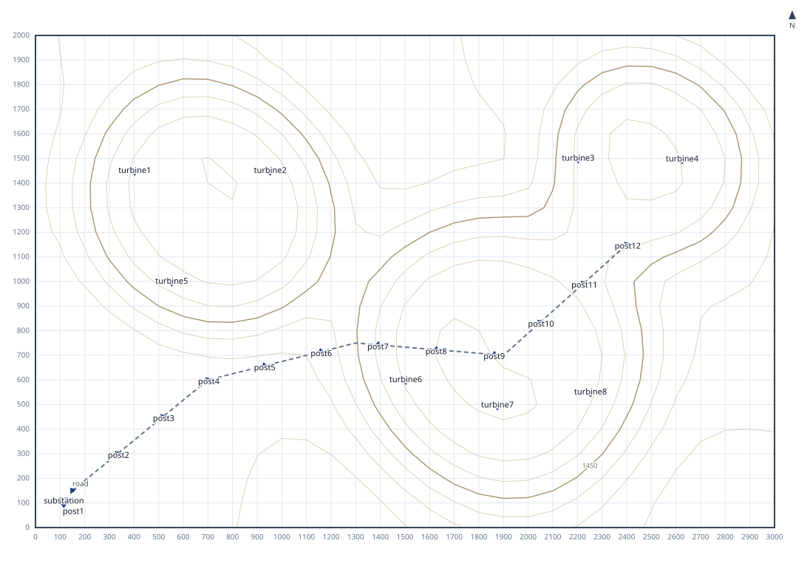 | 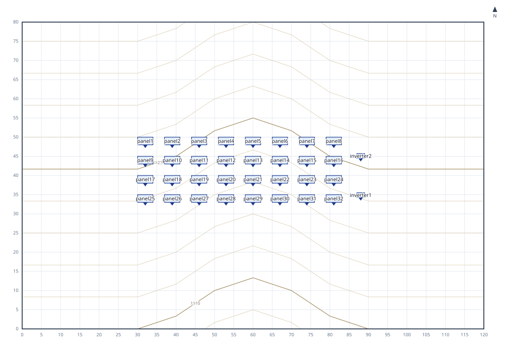 | 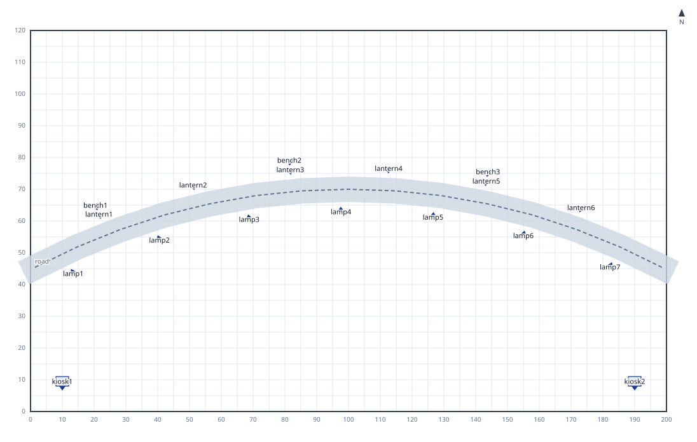 |
| 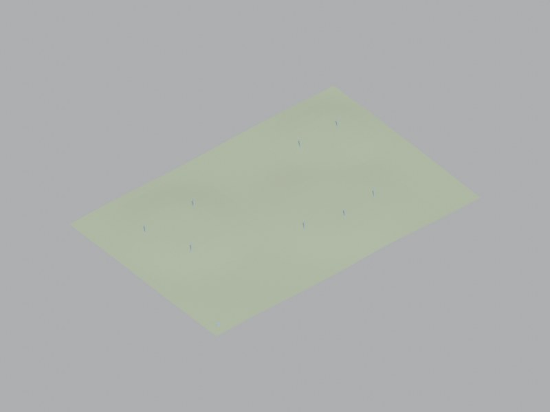 | 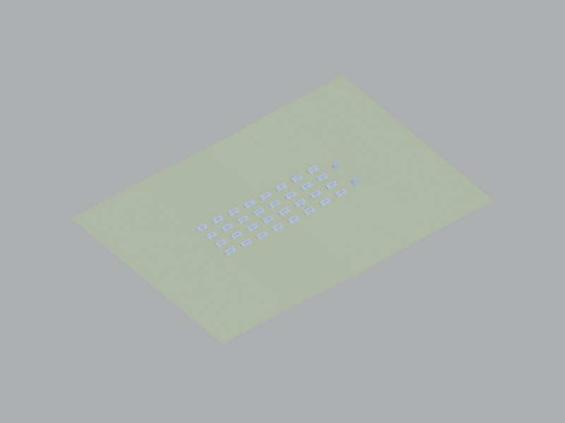 | 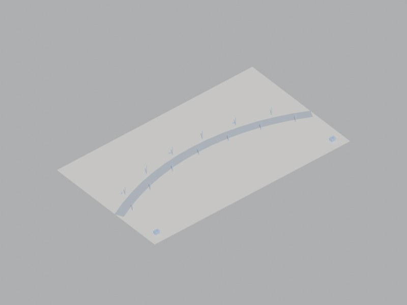 |

阵列用到两个关系：`tilt <度数>` 让物体向正面倾斜（如朝向太阳的光伏板）。物体会被抬高，让最低的一角落在所站的高度上；输出给出旋转和 `up`。`tilt` 与 `align to slope` 不能同时用于一个物体（`scene.tilt.conflict`）。`keep clear <长度> between <组>` 让组内每两个物体之间（边到边）至少相距这么远。

## 输出

`renderSceneDsl(source, { format })`，或 `agh --input room.yaml --format …`：

- **`scene-json`**（默认）：`dge-scene` v1 文档，格式见 [`schema/dge-scene.v1.schema.json`](../schema/dge-scene.v1.schema.json)，数值保留 4 位小数。每个物体给出：
  - `position`：底面中心和底面高度 `[x, y, z]`；
  - `yaw`，以及旋转四元数 `quaternion` `[x, y, z, w]`（先转角，再加上随坡面的倾斜，倾斜时同时给出 `up`）；
  - `size` 和 `front`；
  - `supportedBy`；
  - 世界坐标包围盒 `aabb`。

  文档还包含 `valid`、诊断信息和 `unplaced`：位置、转角或尺寸算不出有限数值的物体会被排除在外并列在这里（诊断为 `scene.non-finite`），所以写出的每份文档都符合 v1 schema。
- **`blender`**：嵌入了场景数据的 Blender（bpy）Python 脚本。
  - 每个方块的原点在底面中心，所以它在 Blender 里的位置就等于 `position`，绕 z 轴的旋转就是 `yaw`。
  - 顶面画一个三角标出正面。
  - `asset` 对应文件里已有的同名集合时，放置该集合的实例。
  - 门洞是横跨墙线的色条。每条路径是地面上的一条曲线，它的智能体是一个圆柱（半径、高度与智能体一致），按路径的时刻沿路径行走，每秒 24 帧。
  - 所有东西放进一个以场景命名的集合，重复运行脚本会重建。
  - 无界面渲染（Cycles 用 CPU，不需要显卡）：`blender -b --python room.py -- --render room.jpg [--size 1200x900] [--samples 24] [--frame 72]`。`--frame` 选取行走中的某一刻：第 0 帧是第一个智能体出发的时刻，每秒 24 帧（72 即之后第 3 秒）。行走时间长到超出 Blender 的帧数范围时会放慢以容纳（`fps_base`），场景里记录 `dge_time_origin` 和 `dge_fps`。`--animation room.mp4` 把整段行走渲染成视频。
- **`gltf`** 和 **`glb`**：glTF 2.0（`.gltf` 为 JSON，缓冲区内嵌；`.glb` 为单个二进制文件，`renderSceneDsl` 用 `bytes` 返回），可导入 Three.js、Blender、游戏引擎等三维工具。两种格式都能通过 Khronos 官方 glTF Validator，没有任何问题项。
  - glTF 以 y 轴向上：每个点 (x, y, z) 写成 (x, z, -y)，每个旋转 [x, y, z, w] 写成 [x, z, -y, w]。会把 y 向上转回 z 向上的导入器（Blender 的就是）得到的正是文档里的 `position` 和 `quaternion`。
  - 每个物体是一个占位方块（原点在底面中心，顶面三角标出正面，按叠放层级着色）。节点的 `extras` 里有 `dge_id`、`dge_front`、`dge_size`，以及有值时的 `dge_supported_by`、`dge_asset`、`dge_group`、`dge_label`、`dge_geo`（导入器会保留为自定义属性），工具可以据此把方块换成对应资产。
  - 地面（或地形网格）、门洞、路径、线路、航点（折线加点）和地标标杆也一并导出。每条路径的智能体是一个圆柱，放在名为 `agents` 的动画里，每 0.1 秒及每个拐点一个关键帧；时间 0 是第一个智能体出发的时刻（根节点的 `dge_time_origin`）。
- **`usda`**：文本形式的 USD 场景，可导入 Omniverse、Blender、Houdini 等 USD 工具。用 USD 自带的全部校验器（`UsdValidation`）检查，没有任何错误。
  - 场景以 z 轴向上、单位为米（`upAxis = "Z"`、`metersPerUnit = 1`），就是场景坐标系本身。每个物体是一个 Xform，`xformOp:translate` 就是 `position`，`xformOp:orient` 就是 `quaternion`（w 在前）。下面挂一个占位方块 `box` 和正面三角 `front`，材质用 UsdPreviewSurface，按叠放层级着色。
  - Prim 名由 id 转成合法标识符（`-` 变 `_`，重名加 `_2`）。原始 id 以及正面、尺寸、支撑物、资产、分组、标签、经纬度写成 `userProperties:dge_*` 属性，Blender 导入后是自定义属性。
  - `assetPath`（`--asset-path ./assets/{asset}.usd`）：指定了 `asset` 的物体会有一个 `geometry` 变体集。其中 `asset` 变体（默认选中）引用该文件的默认 prim，`placeholder` 变体保留占位方块。资产的原点应在底面中心，正面是声明的 `front`，单位米、z 轴向上。
  - 地面或地形、门洞、路径、线路和航点（线性 BasisCurves，航点另有 Points）、地标标杆也一并导出。智能体的位移按每秒 24 个时间码沿路径采样；图层 customLayerData 里的 `dge_time_origin` 给出时间码 0 对应的场景秒数。
- **`svg`**：用于肉眼核对的俯视图：
  - 上为北，0.5 m 网格；
  - 每个物体的正面画一个三角；
  - 叠放的物体按层级着色；
  - 出错的物体用红框标出，诊断信息列在图下。

场景无效（`valid: false`）时，CLI 照样输出结果，退出码为 1，方便直接看到问题；文档本身写法不合法时什么都不输出。`--page` 这类只用于图表的参数会被拒绝。

## 诊断

| 代码 | 含义 |
| --- | --- |
| `validate.scene.*` | 文档本身的问题（包括同一面墙上重叠的门洞、没有 `frame` 却写了经纬度、未知地标）：未知物体或动词（附“是否想写 …”提示）、动词不接受的修饰、数值不合法、保留字、需要单个物体的地方用了组 |
| `scene.layout.conflict` | 关系（或钉住的位置）之间无法同时成立，并指出涉及哪些物体 |
| `scene.collision` | 两个物体互相穿插（附穿插深度） |
| `scene.out-of-bounds`、`scene.above-ceiling` | 越过墙壁或天花板（附超出多少） |
| `scene.support.unstable` / `scene.support.overhang` | 中心落在支撑面外（会掉下去）/ 伸出支撑面边缘 |
| `scene.keep-clear`、`scene.min-gap` | 小于通道宽度 / `minGap` |
| `scene.yaw.conflict` | 同一物体被指定了两个不同的转角 |
| `scene.support.multiple`、`scene.support.cycle` | 一个物体放在两个物体上，或几个物体互相叠放成环 |
| `scene.relation.off-floor` | 平面关系涉及放在其他物体上的物体（该关系不生效） |
| `scene.path.blocked` | 走不通：瓶颈位置、宽度和所需宽度；或者被围住的地点（端点或途经点） |
| `scene.path.opening-narrow` | 门洞比智能体宽度加两侧净空还窄 |
| `scene.path.unplaced` | 路径去往不在布局里的物体 |
| `scene.geo.extent`（警告） | `projection: enu` 的场景离坐标原点超过 10 km |
| `validate.scene.geo-extent`（错误） | 坐标系放不下的经纬度点：离局部坐标系原点超过 10 km、超出 UTM 范围，或超出 Web Mercator 边缘 |
| `scene.geo.projection`（提示） | 大场地改用了 UTM 投影带（附带号和 EPSG 代码） |
| `scene.geo.zone-crossing`（警告） | UTM 场地伸进了另一个投影带（仍按本带投影，附最远处的格网比例） |
| `scene.terrain.slope`、`scene.terrain.elevation` | 物体脚下的地面比 `slope below` 更陡，或超出高程限制（附测量值） |
| `scene.terrain.outside` | 地面上的物体伸出了地形网格 |
| `scene.terrain.leaning-support` | 物体放在随坡倾斜的支撑物上 |
| `scene.terrain.off-ground`（警告） | 对放在支撑物上的物体写了 `on terrain` 或 `align to slope` |
| `scene.terrain.uneven`（提示） | 直立物体脚下地面起伏超过 10 cm：悬空和埋入各多少 |
| `scene.terrain.moved`（提示） | 物体被移到最近的满足限制条件的地面 |
| `validate.scene.along-overflow`、`validate.scene.unknown-line`、`validate.scene.line-points` | 间距超出线长；未知的线；线同时写了或都没写 `points` 和 `geo` |
| `scene.tilt.conflict` | 同一物体有两个倾角，或同时有倾角和 `align to slope` |
| `scene.line.overlap` | 地面上的物体压在道路（带宽度的线）上，给出压入深度 |
| `scene.line.moved`（info） | 物体被挪到最近的、不压路的位置 |
| `scene.waypoint.low`、`scene.waypoint.collision`（警告） | 航点之间的航段离地低于 `min` / 穿过物体 |
| `scene.path.single-file`（提示） | 两条路径在窄到无法错身的地方迎面相遇 |
| `scene.path.head-on`（提示） | 两条路径仍迎面共用一段：让道会超出长度上限、有一条是 `comfort 0`，或轮数用完 |
| `scene.path.detour`（提示） | 路径长度超过途经点间直线距离的两倍 |
| `scene.path.made-way`（提示） | 为让被挡的路径通过而隔开的两样东西 |
| `scene.path.meet`（警告） | 两个有出发时刻的智能体在路上会碰到：时间、地点，以及能错开的推迟出发时间 |

## 在 Blender 中核对

`test/support/blender_check.py` 在 Blender 里运行生成的脚本，与 JSON 比对：
- 每个物体的世界坐标包围盒（由网格顶点算出）和转角，精度 1e-4；
- 每个门洞色条在墙上的位置、每条路径曲线的折点，精度 1e-4；
- 每个智能体在各折点时刻所处的位置（在对应帧上求动画曲线的值），精度 1e-3；
- 有地形时，按文档里的网格独立计算地面：每个网格顶点都在地面上，地面上每个物体的底面中心站在地面上（误差 1 cm 内），路径和智能体贴着地面，倾斜物体的四元数和上方向一致，每个地标都有标杆。

`test/support/gltf_check.py` 把每个用例的 `.glb` 导入 Blender，同样比对每个物体的世界坐标包围盒和转角。`test/support/usd_check.py` 用 USD 官方库（`pip install usd-core`，`DGE_USD_PYTHON`）打开每个用例的 `.usda`，运行全部 USD 校验器，并比对变换、包围盒和智能体时刻；`test/support/usd_blender_check.py` 通过 Blender 的 USD 导入器做同样的比对。`test/scene-gltf.test.ts` 每次改动都运行：官方 Validator 校验，以及在 Three.js 中加载每个 `.glb`，逐个物体比对世界坐标位置、转角和包围盒。

这项核对在关键节点运行（改动 Blender 导出、阶段收尾、发版前），不是每次改动都跑：

```bash
pip install bpy        # 需要 Python 3.11 环境
DGE_BLENDER_PYTHON=$(which python) npx vitest run test/scene-export.test.ts
DGE_BLENDER_PYTHON=$(which python) npm run docs:scene-renders   # 生成 README 里的渲染图
```

## 第一阶段的限制

- 物体绕竖直轴转动；在地形上还可以随坡面倾斜。底面轮廓是带方向的矩形，高度是一个区间；倾斜物体按直立时的底面轮廓和倾斜后盒子的高度范围检查。
- 平面关系只在地面上的物体之间生效；放在其他物体上的物体用 `at` 定位。
- “在某物旁边”类关系会把参照物的那一侧就近对齐到世界坐标轴。转了角度的物体，分离和贴墙都按它的外包矩形算（偏保守）；穿插检测仍用真实的旋转轮廓。
- 求解器只保证关系成立，不保证布局舒适。重要的要求需要写明，例如用 `keep clear` 留出拉椅子的空间。
